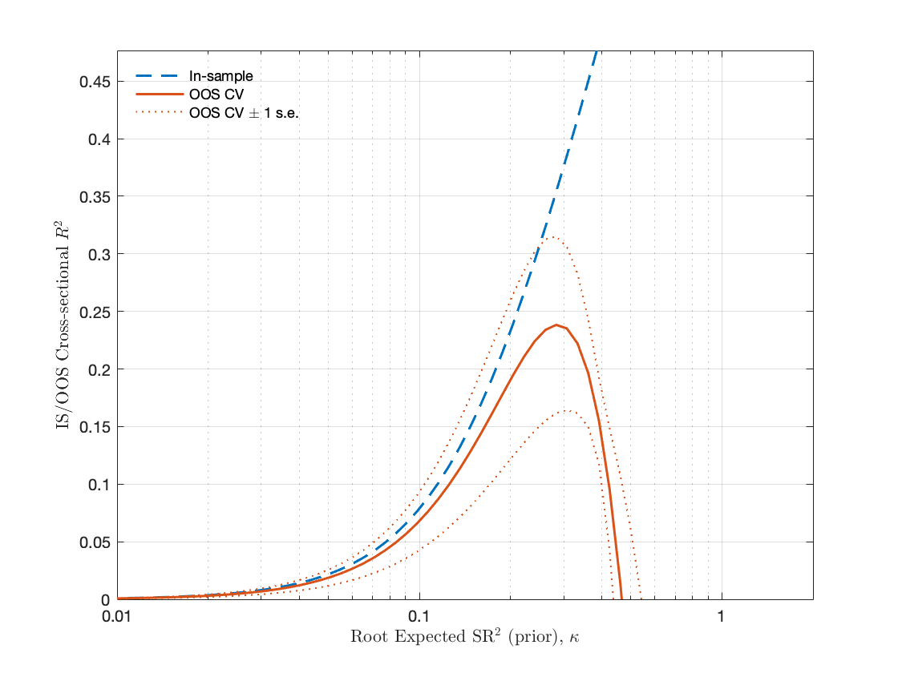
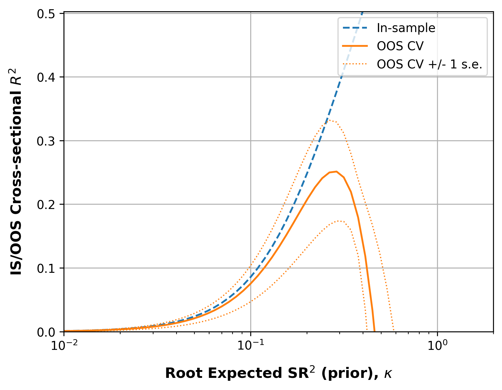
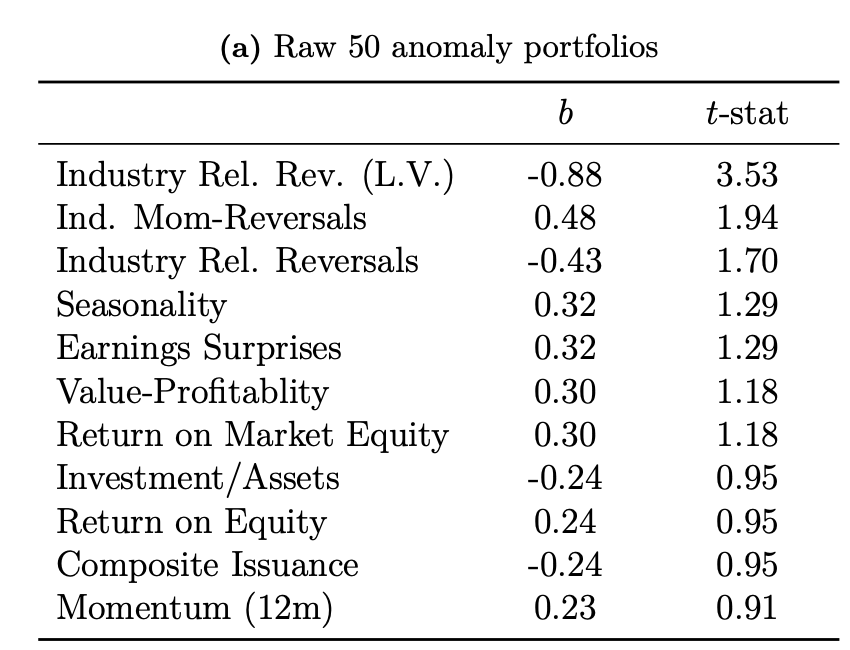
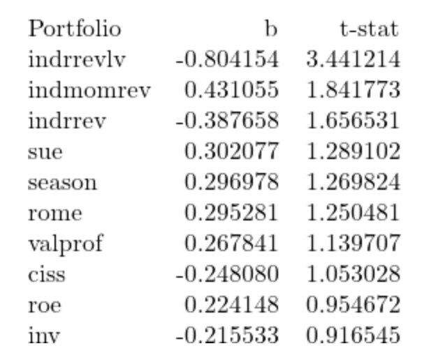
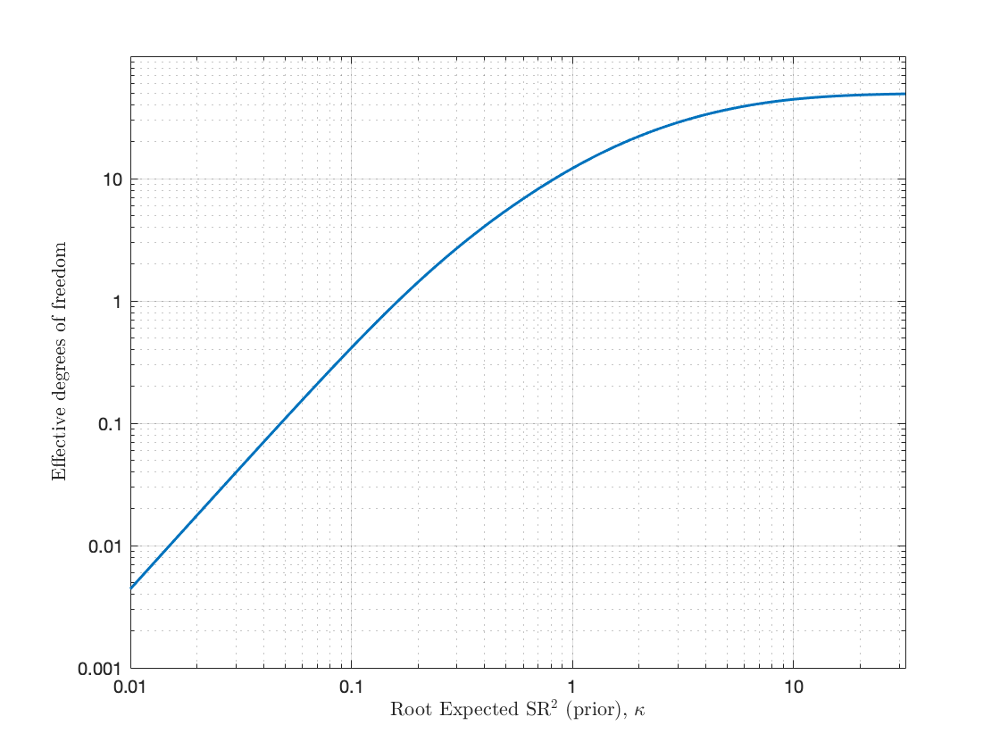
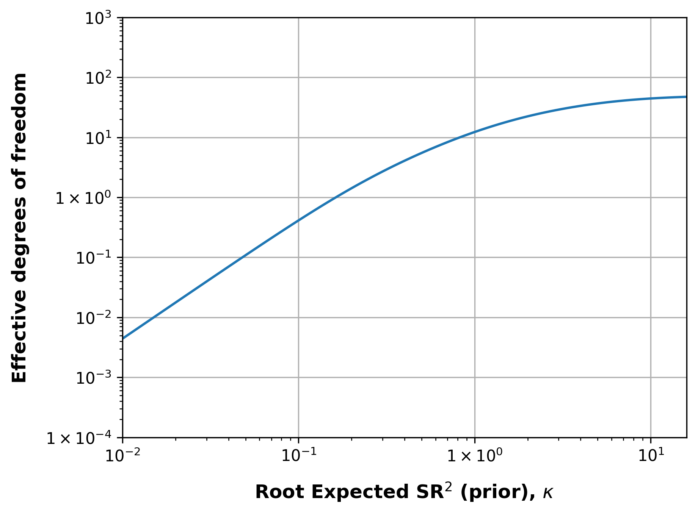
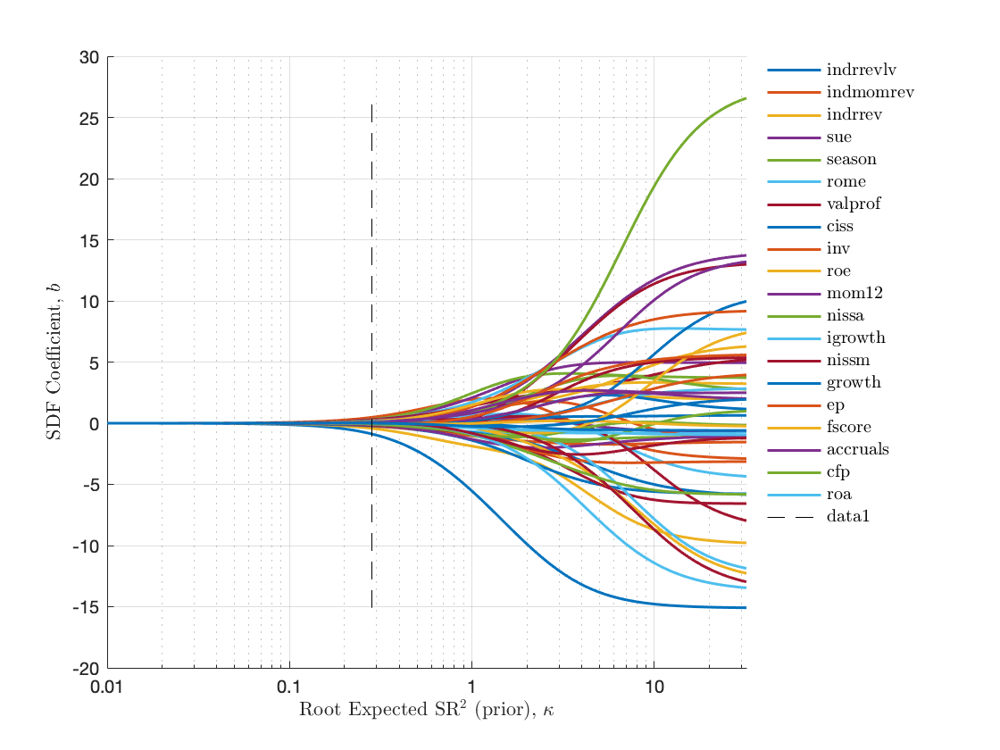
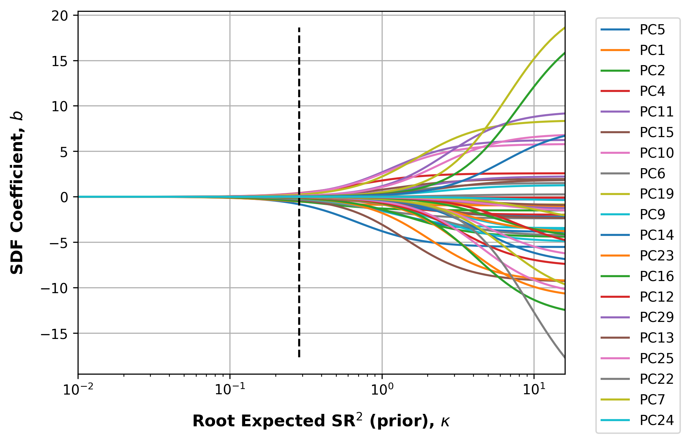
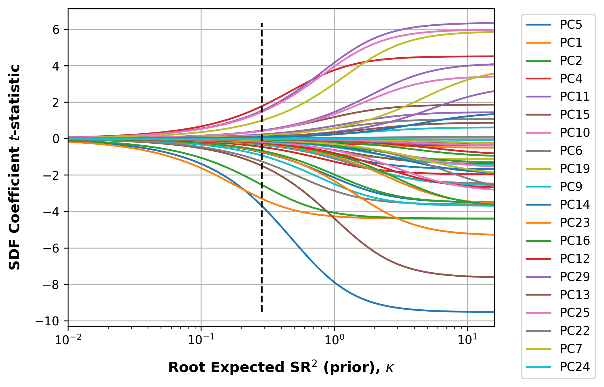

# Replication: Shrinking the Cross-Section

This repository hosts the replication of findings from the paper titled *Shrinking the Cross-Section* by **S. Kozak, S. Nagel, and S. Santosh**, published in the Journal of Financial Economics in 2020. The paper explores the construction of a robust stochastic discount factor (SDF) that encapsulates the collective explanatory power of numerous cross-sectional stock return predictors through an economically substantiated prior on SDF coefficients, providing a robust out-of-sample performance in high-dimensional settings.

[Link to the original paper on SSRN](https://papers.ssrn.com/sol3/papers.cfm?abstract_id=2945663).

## Abstract:
> We construct a robust stochastic discount factor (SDF) that summarizes the joint explanatory power of a large number of cross-sectional stock return predictors. Our method achieves robust out-of-sample performance in this high-dimensional setting by imposing an economically motivated prior on SDF coefficients that shrinks the contributions of low-variance principal components of the candidate factors. While empirical asset pricing research has focused on SDFs with a small number of characteristics-based factors --- e.g., the four- or five-factor models discussed in the recent literature --- we find that such a characteristics-sparse SDF cannot adequately summarize the cross-section of expected stock returns. However, a relatively small number of principal components of the universe of potential characteristics-based factors can approximate the SDF quite well.

## Dataset and Original Code:
For datasets and code, please see [Serhiy Kozak's webpage](https://www.serhiykozak.com/data).


## The `kns` package

The validated estimator and the full replication are packaged as an installable
library, `kns`. There is a single source of truth for the numerical engine
(`kns.core`, `kns.dual_penalty`); the old top-level scripts have been retired.

### Install
```bash
pip install -e .            # from the repo root (editable install)
```

### Fit the SCS estimator to your own return data
```python
import pandas as pd
from kns import fit_scs

returns = pd.read_csv("my_returns.csv", index_col=0, parse_dates=True)  # T x N
result = fit_scs(returns, objective="CSR2", kappa="cv")   # K-fold CV picks the shrinkage

result.b                # SDF coefficients (eq. 22)
result.mve_weights      # MVE portfolio weights on your input assets
result.kappa            # selected shrinkage
result.cv_curve         # IS/OOS objective vs kappa
result.predict(returns) # realized MVE/SDF-mimicking portfolio returns
result.sharpe(returns)  # annualized Sharpe of that portfolio
```
`fit_scs` does *no* preprocessing by default — set `demarket=True, devol=True`
(and pass `market=`) for the paper's market-neutral pipeline. It supports the
dual L1+L2 penalty (`dual_penalty=True`), the cross-validated-Sharpe objective
(`objective="SR"`), PC rotation, and a configurable covariance shrink
(`cov_shrink=`); it raises on unrecoverable misuse and warns when the data leave
the validated regime (non-daily frequency, `T < 2N`, material covariance shrink).
Posterior eq.-(23) standard errors are reported as `se` / `tstat_posterior`.

### Reproduce the whole paper replication
```bash
python -m kns.reproduce          # every figure/table -> replication/build/output/
python -m kns.reproduce --list   # available sections
```
or in Python: `from kns.reproduce import reproduce_all; reproduce_all()`.

## Repository Structure
- **`src/kns/`** — the installable package: `core.py` + `dual_penalty.py` (engine),
  `estimator.py` (`fit_scs`), `reproduce/` (the paper figures/tables, one entry point).
- **`tests/`** — acceptance + numerical-validation suite (`pytest`).
- **`replication/`** — the replication plan, report, and committed outputs.
- **`Data/`** — the datasets referenced in the paper.

# Results
Comparison of original results from the paper and replication results from the Python script, aligned side-by-side for comparison.

## L2 Model Selection
### In-sample and Out-of-Sample Cross-Sectional R^2 Analysis
> This section displays the original and replicated plots that present the in-sample cross-sectional R^2 (dashed line), out-of-sample (OOS) cross-sectional R^2 based on cross-validation (solid line), and OOS cross-sectional R^2 based on the proportional shrinkage (dash-dot line) as per Pástor and Stambaugh (2000).

#### Original


#### Replicated



### Largest SDF factors
> Coefficient estimates and absolute t-statistics at the optimal value of the prior root expected SR2 (based on cross-validation), with focus on the original 50 anomaly portfolios. Coefficients are sorted descending on their absolute t-statistic values.

#### Original


#### Replicated


### Degrees of Freedom
> TODO

#### Original


#### Replicated


## SDF Coefficients

### Coefficient Paths
> TODO

#### Original


#### Replicated


### t-Statistic Paths
> TODO

#### Original


#### Replicated



